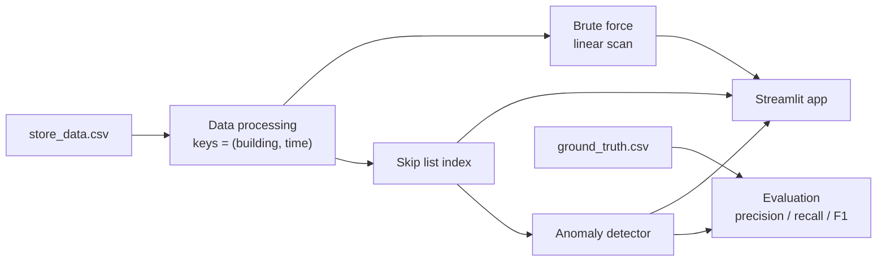
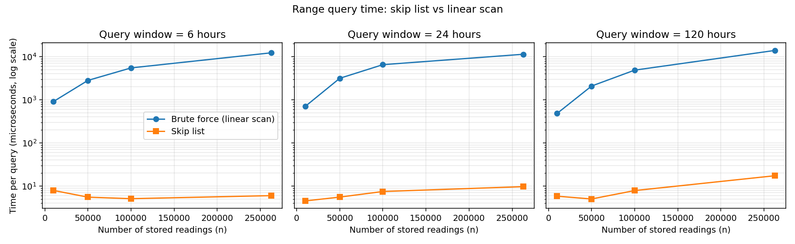

# Electricity Consumption Time-Series Anomaly Detector

A small time-series database written from scratch in Python. It stores hourly electricity
meter readings, answers "all readings of building X between time A and time B" with a
**skip list index** instead of scanning every row, and flags unusual spikes and drops with
**plain statistics (no machine learning)**. An interactive **Streamlit** app ties it together.

Course project for DS603, Data Structure Algorithms in Python.

## Highlights

- **Skip list built from scratch** (no `bisect`, `sortedcontainers` or tree libraries): insert, search and range query in expected O(log n + k).
- **Roughly 800 to 2,000 times faster than a linear scan** on 262,719 readings: about 6 to 17 microseconds per query versus 10 to 14 milliseconds (see the benchmark below).
- **Statistical anomaly detection** per building (mean and standard deviation, optionally per hour of day), built on top of the fast range queries.
- **Honest evaluation** against labelled ground truth: precision, recall, F1, with the threshold tuned on one half of the buildings and scored on the other half.
- **Interactive app**: query any building and time window, see flagged anomalies on a chart, and compare skip list and brute force live.
- **59 automated tests**, including a comparison of every skip list answer with a brute-force scan.

## Dataset

| | |
|---|---|
| Readings | 262,719 hourly electricity meter readings (`data/store_data.csv`) |
| Buildings | 192 |
| Period | 12 blocks of about 5 days each (one per month of 2016) |
| Labels | `data/ground_truth.csv`: 3,144 readings (1.2 %) labelled anomalous |

## How it works



**1. Index.** Every reading is stored in a skip list under the key `(building_id, time)`, so one
building's readings sit together in time order. A skip list is a sorted linked list with random
"express lanes": a search moves right along the top lane while the next key is still too small,
then drops down a level, and repeats.

```
Level 3:  HEAD ---------------------------> 40 ------------------> None
Level 2:  HEAD ---------> 10 -------------> 40 ------> 70 -------> None
Level 1:  HEAD --> 5 ---> 10 --> 25 ------> 40 --> 55 --> 70 --> 90 -> None
```

**2. Range query.** "Building B between t1 and t2" finds the first key at or after `(B, t1)` in
about log n steps, then walks forward until it passes `(B, t2)`. Example: building 107 over 24 hours
returns 24 readings after 47 key comparisons, while the brute force reads all 262,719 rows.

**3. Anomaly detection.** Fetch a building's history with one range query, compute its mean and
standard deviation, and flag any reading whose z-score `(value - mean) / std` exceeds a threshold `k`
(spike if above, drop if below). The baseline can be per building or per hour of day, because
electricity use follows a daily cycle. A separate, dataset-specific rule also flags readings of exactly
`1.0`, which behave like a placeholder value in this data.

## Results

### Query speed

Skip list versus linear scan, same queries, same rows, pure Python, best of several runs:



The linear scan grows with the number of stored readings; the skip list stays almost flat.
Exact numbers are in `benchmark_results.csv`. Every skip list answer is checked against the brute
force before it is timed.

### Anomaly detection accuracy

Threshold `k` chosen on 96 buildings, scored on the 96 held-out buildings:

| Method | k | Precision | Recall | F1 |
|---|---|---|---|---|
| building z-score | 2.5 | 0.270 | 0.210 | 0.236 |
| hourly z-score | 3 | 0.349 | 0.226 | 0.274 |
| stuck-value rule only (reading = 1.0) | - | 1.000 | 0.299 | 0.461 |
| building z-score + stuck-value rule | 5 | 0.922 | 0.309 | 0.463 |
| hourly z-score + stuck-value rule | 5 | 0.927 | 0.314 | 0.469 |

The numbers move with the choice of test buildings. Over six different splits, F1 for the best
configuration (hourly z-score + stuck-value rule) ranged from 0.47 to 0.60, and for the z-score
alone from 0.24 to 0.35. Plain accuracy is not reported because only 1.2 % of readings are anomalies,
so a detector that flags nothing would already score 98.8 %.

## Getting started

Requires Python 3.9 or newer (tested on 3.12 and 3.13).

```bash
git clone https://github.com/<your-username>/Electricity-Consumption-Timeseries-Anomaly-Detector.git
cd Electricity-Consumption-Timeseries-Anomaly-Detector
pip install -r requirements.txt
```

Make sure the two data files are in the `data/` folder:

```
data/store_data.csv
data/ground_truth.csv
```

Then run whichever part you want:

```bash
streamlit run app.py          # the interactive app
python benchmark.py           # skip list vs brute force timing
python run_anomaly_eval.py    # anomaly detection accuracy
python -m pytest              # all tests
```

### Using the store from Python

```python
from timeseries_store import TimeSeriesStore
from anomaly import AnomalyDetector

store = TimeSeriesStore.from_csv("data/store_data.csv", seed=42)

# all readings of building 107 between two times
store.query(107, "2016-01-01 09:00", "2016-01-02 08:00")

# anomalies in a window (hourly baseline, threshold k = 3)
detector = AnomalyDetector(store, method="hourly", k=3.0)
for a in detector.detect(159, "2016-08-01", "2016-08-05 23:00"):
    print(a.time, a.value, a.kind, round(a.score, 1))
```

## The app

`streamlit run app.py` opens four tabs:

1. **Explore & detect**: readings, the normal band, and flagged spikes, drops and stuck values, with the ground-truth anomalies available as an overlay.
2. **Skip list vs brute force**: the same query on both methods, with time, work done and a check that the results are identical.
3. **Accuracy**: correct flags, false alarms and misses for the current window, plus precision, recall and F1 across all buildings.
4. **About**: a short explanation of the method.

Tip: with the default threshold the detector flags few spikes and drops. Set `k = 3` and try
buildings 159 (August block), 183 or 890 to see them.

<!-- Add screenshots here once you have them, for example:
 -->

## Project structure

```
.
├── README.md
├── requirements.txt
├── data/
│   ├── store_data.csv
│   └── ground_truth.csv
├── docs/
│   └── TEAM_GUIDE.md          detailed guide to every part
├── skiplist.py                the skip list index
├── timeseries_store.py        data loading, keys and the query layer
├── brute_force.py             linear-scan baseline and correctness oracle
├── benchmark.py               skip list vs brute force timing
├── anomaly.py                 statistical anomaly detector
├── evaluation.py              ground-truth loading and accuracy metrics
├── run_anomaly_eval.py        full accuracy evaluation
├── app.py                     Streamlit app
├── ui_helpers.py              helper functions for the app
├── test_skiplist.py           skip list and store tests
├── test_anomaly.py            anomaly detection tests
├── test_ui.py                 app and helper tests
├── benchmark_results.csv      generated by benchmark.py
├── benchmark_plot.png         generated by benchmark.py
├── anomaly_results.csv        generated by run_anomaly_eval.py
└── anomaly_tuning_sweep.csv   generated by run_anomaly_eval.py
```

## Testing

```bash
python -m pytest
```

The 59 tests cover the skip list (unit, edge cases, randomised comparison against a reference),
the store and brute force (every answer compared on real data, including ranges inside the data gaps),
the anomaly detector (planted spikes and drops with known positions, plus hand-computed metrics),
and the app (a headless run that clicks through the controls). Tests that need the CSV files are
skipped if `data/` is missing.

## Limitations

- Everything is in memory and in pure Python; there is no persistence to disk and no `delete` operation.
- A NumPy-based scan would be faster than our pure-Python brute force, so the speed-up figures compare against a plain Python scan.
- About 62 % of the labelled anomalies are not at the `1.0` value, and many of them look normal by value. Statistics on values alone cannot separate them from normal readings, which caps recall.
- The `1.0` rule is specific to this dataset and was found by inspecting the data with its labels, so it is not a blind result.
- The baseline uses a building's whole history, which suits offline analysis but not live streaming.

## Documentation

See [`docs/TEAM_GUIDE.md`](docs/TEAM_GUIDE.md) for a walkthrough of each part (data processing,
brute force, skip list, anomaly detection, UI) with worked examples.

## Team

- `<Name>`: `<part>`
- `<Name>`: `<part>`
- `<Name>`: `<part>`

## Reference

W. Pugh, "Skip Lists: A Probabilistic Alternative to Balanced Trees", *Communications of the ACM* 33(6), 1990.