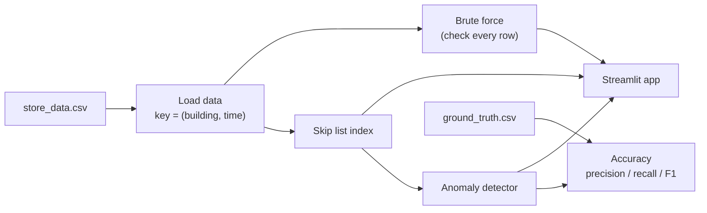
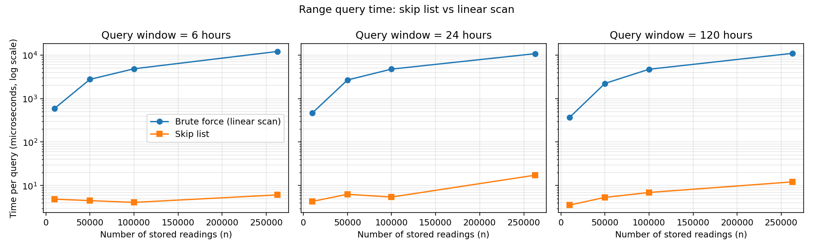

# Electricity Consumption Time-Series Anomaly Detector

A small time-series database written from scratch in Python. It:

1. **stores** hourly electricity meter readings for 192 buildings,
2. **answers** "give me all readings of building X between time A and time B" quickly, using a
   **skip list** we wrote ourselves instead of scanning every row,
3. **flags unusual readings** (anomalies) with simple statistics, no machine learning,
4. **shows** all of it in an interactive **Streamlit** app.

Course project for DS603, Data Structure Algorithms in Python.

**Live demo:** [electricity-consumption-timeseries-anomaly-detector-23ckezkmzm.streamlit.app](https://electricity-consumption-timeseries-anomaly-detector-ubbfhqjdzh.streamlit.app/)

## Highlights

- **Skip list built from scratch**: insert, search and range query take about log(n) steps.
- **Hundreds to thousands of times faster than scanning every row**: on all 262,719 readings, a
  query takes about 6 to 17 microseconds with the skip list and about 11 to 12 milliseconds with
  a linear scan.
- **Anomaly detection with plain statistics**: mean, standard deviation and two simple rules.
- **Honest accuracy numbers**: settings are chosen on half of the buildings and tested on the
  other half.
- **61 automated tests**, including checking every skip list answer against a linear scan.

## Dataset

| | |
|---|---|
| Source | [Kaggle: Energy Anomaly Detection](https://www.kaggle.com/competitions/energy-anomaly-detection/data) |
| Readings | 262,719 hourly meter readings, in `data/store_data.csv` |
| Buildings | 192 |
| Time period | 12 blocks of about 5 days, one per month of 2016 |
| Labels | `data/ground_truth.csv` marks 3,144 readings (1.2 %) as anomalies |

## How it works



**1. Store.** Each reading is saved in the skip list under the key `(building_id, time)`.
Python sorts tuples by the first item, then the second, so all readings of one building end up
next to each other, in time order.

**2. Query.** A skip list is a sorted linked list with extra "express lanes" on top. To find
building B from time t1 to t2, it uses the express lanes to jump to `(B, t1)` in about log(n)
steps, then walks forward until it passes `(B, t2)`.

```
Level 3:  HEAD ---------------------------> 40 ------------------> None
Level 2:  HEAD ---------> 10 -------------> 40 ------> 70 -------> None
Level 1:  HEAD --> 5 ---> 10 --> 25 ------> 40 --> 55 --> 70 --> 90 -> None
```

Example: building 107 over 24 hours gives 24 readings after only 47 comparisons. The brute force
has to look at all 262,719 rows to find the same 24.

**3. Detect anomalies.** For each building we compute what is "normal": the average (mean) and
the typical spread (standard deviation), optionally separately for each hour of the day. Then:

- **Spike / drop:** the reading is more than `k` standard deviations above / below normal.
- **Stuck value:** the reading is exactly `1.0`, which acts as a "meter broken" placeholder in
  this dataset.
- **Gap edge:** the reading sits right next to a short hole (2 to 6 missing hours) in the data.

## Results

### Query speed

Same queries, same data, both in pure Python:



The linear scan gets slower as more readings are stored; the skip list stays almost flat.
Exact numbers: `benchmark_results.csv`.

### Anomaly detection accuracy

We repeated "choose settings on half the buildings, test on the other half" for 10 random
splits. Average test scores, with the lowest and highest in brackets:

| Method | Precision | Recall | F1 |
|---|---|---|---|
| hourly z-score only | 0.32 [0.21-0.48] | 0.30 [0.22-0.37] | 0.30 [0.24-0.36] |
| stuck-value rule only | 1.00 [1.00-1.00] | 0.36 [0.28-0.42] | 0.53 [0.43-0.59] |
| **stuck-value + gap-edge rules (best F1)** | **0.81 [0.68-0.91]** | **0.52 [0.41-0.58]** | **0.63 [0.56-0.71]** |
| high-recall mode (app default) | 0.62 [0.48-0.72] | 0.58 [0.47-0.65] | 0.59 [0.54-0.68] |

- **Precision**: of the readings we flagged, how many were real anomalies.
- **Recall**: of the real anomalies, how many we found.
- **F1**: one number combining both.

We don't report plain accuracy: only 1.2 % of readings are anomalies, so a detector that never
flags anything would already be 98.8 % "accurate".

**High-recall mode** also flags the hour before and after each flagged reading. It finds more
real anomalies but raises more false alarms. The app uses it by default, because for electricity
meters a missed fault (wrong bills, wasted energy) usually costs more than checking a false
alarm. Full tables and explanation: [docs/README_anomaly.md](docs/README_anomaly.md).

## Getting started

Requires Python 3.9 or newer (tested on 3.12 and 3.13).

```bash
git clone https://github.com/Khushboo282/Electricity-Consumption-Timeseries-Anomaly-Detector.git
cd Electricity-Consumption-Timeseries-Anomaly-Detector
pip install -r requirements.txt
```

The two data files must be in the `data/` folder (`data/store_data.csv`, `data/ground_truth.csv`).

Then run the steps in the order of the file numbers:

```bash
python -m pytest                   # run all 61 tests (about 30 s)
python 05_benchmark.py             # skip list vs brute force timing
python 08_run_anomaly_eval.py      # anomaly detection accuracy (about 1 min)
streamlit run 10_app.py            # the interactive app (opens in your browser)
```

### Why the file names start with numbers

The numbers show the order the project is built in. Python's normal `import` can't load a name
that starts with a digit, so the files load each other like this:

```python
from importlib import import_module
_timeseries_store = import_module("03_timeseries_store")
TimeSeriesStore = _timeseries_store.TimeSeriesStore
```

### Using it from Python

```python
from importlib import import_module
TimeSeriesStore = import_module("03_timeseries_store").TimeSeriesStore
AnomalyDetector = import_module("06_anomaly").AnomalyDetector

store = TimeSeriesStore.from_csv("data/store_data.csv", seed=42)

# all readings of building 107 between two times
store.query(107, "2016-01-01 09:00", "2016-01-02 08:00")

# anomalies in a window (hourly baseline, threshold k = 3)
detector = AnomalyDetector(store, method="hourly", k=3.0)
for a in detector.detect(159, "2016-08-01", "2016-08-05 23:00"):
    print(a.time, a.value, a.kind, round(a.score, 1))
```

## The app

`streamlit run 10_app.py` opens four tabs:

1. **Explore & detect**: a chart of the readings with flagged anomalies marked.
2. **Skip list vs brute force**: the same query on both, timed side by side.
3. **Accuracy**: precision, recall and F1 against the labels.
4. **About**: a short explanation.

Tip: to see red spikes and purple drops, set `k = 3` and pick building 159 (August block), 183
or 890. Details: [docs/README_ui.md](docs/README_ui.md).

## Project structure

```
.
├── README.md                this file
├── requirements.txt         Python packages to install
├── pytest.ini               lets pytest find the numbered test files
├── data/                    store_data.csv, ground_truth.csv
├── docs/                    detailed guides (see below)
│
├── 01_preprocess.ipynb      PREP: cut the raw Kaggle file down to its first 700,000 rows
├── 02_skiplist.py           the skip list
├── 03_timeseries_store.py   loads the CSV, builds keys, answers queries
├── 04_brute_force.py        linear scan (for speed comparison and checking answers)
├── 04_test_skiplist.py      TEST: skip list, store, brute force
├── 05_benchmark.py          RUN:  skip list vs brute force timing
├── 06_anomaly.py            the anomaly detector
├── 07_evaluation.py         precision / recall / F1
├── 07_test_anomaly.py       TEST: anomaly detector and metrics
├── 08_run_anomaly_eval.py   RUN:  full accuracy evaluation
├── 09_ui_helpers.py         helper functions for the app
├── 10_app.py                RUN:  the Streamlit app
├── 10_test_ui.py            TEST: the app and its helpers
│
├── benchmark_results.csv    output of 05_benchmark.py
├── benchmark_plot.png       output of 05_benchmark.py
├── anomaly_results.csv      output of 08_run_anomaly_eval.py
└── anomaly_tuning_sweep.csv output of 08_run_anomaly_eval.py
```

## Documentation

| Guide | Read it for |
|---|---|
| [docs/README_team.md](docs/README_team.md) | start here: the whole project, part by part, in plain words |
| [docs/README_data_structure.md](docs/README_data_structure.md) | the skip list and the speed benchmark |
| [docs/README_anomaly.md](docs/README_anomaly.md) | anomaly detection and all accuracy results |
| [docs/README_ui.md](docs/README_ui.md) | the Streamlit app |

## Limitations

- Everything lives in memory; nothing is saved to disk, and readings can't be deleted.
- A NumPy-based scan would be much faster than our pure-Python one. Our speed-up is measured
  against a plain Python scan.
- The `1.0` rule and the gap-edge rule only fit this dataset. We found them by looking at the
  data together with its labels.
- Many labelled anomalies look completely normal by value, so no value-based method can find
  them all. Recall stays around 0.5 to 0.6.

## Team

- `Pratham`: `Data Pre Processing & Anomaly Detection`
- `Khushboo`: `Brute Force`
- `Akanksha`: `Brute Force`
- `Rohan`: `Skipped List`
- `Pujita`: `Skipped List`
- `Rahul`: `Anomaly Detection`
- `Hitesh`: `UI`

## Reference

W. Pugh, "Skip Lists: A Probabilistic Alternative to Balanced Trees", *Communications of the ACM* 33(6), 1990.
