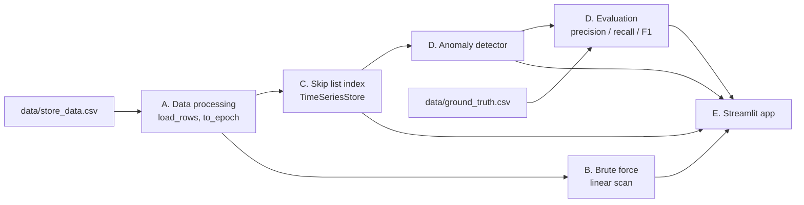

# Electricity Consumption Time-Series Store with Anomaly Detection

A small time-series database, written from scratch in Python, that stores hourly electricity
meter readings, answers "give me all readings of building X between time A and time B"
quickly using a **skip list**, and then flags unusual readings (**anomalies**) using plain
statistics, with a **Streamlit** app on top.

This README is for the team. Read section 1 first, then the section for your part
(sections 2 to 6). Each part section tells you what the part does, which files it
owns, how it works, how to test it, and what you should be able to explain.

---

## Contents

1. [Project overview (everyone reads this)](#1-project-overview-everyone-reads-this)
2. [Part A: Data processing](#2-part-a-data-processing)
3. [Part B: Brute force](#3-part-b-brute-force)
4. [Part C: Skip list](#4-part-c-skip-list)
5. [Part D: Anomaly detection](#5-part-d-anomaly-detection)
6. [Part E: UI (Streamlit app)](#6-part-e-ui-streamlit-app)
7. [Troubleshooting](#7-troubleshooting)
8. [Glossary](#8-glossary)

---

## 1. Project overview (everyone reads this)

### The problem statement

> Build a simple database for storing and querying time-stamped data (like sensor
> readings), designed to quickly retrieve all readings between two given times.
> Implement an efficient indexing structure (such as a Skip List or B-Tree) from scratch
> instead of scanning the full dataset for every query, then layer a basic anomaly-detection
> method on top that flags unusual spikes or drops using the fast range queries.
> Evaluation focuses on correct indexing implementation, query speed compared to a simple
> linear scan, and the accuracy of the anomaly detection.

So there are three things we are graded on, and they map to our parts:

| Graded on | Our part |
|---|---|
| Correct indexing implementation | Part C (skip list) |
| Query speed vs a simple linear scan | Part B (brute force) and Part C, compared in `benchmark.py` |
| Accuracy of the anomaly detection | Part D (anomaly detection) |

Parts A (data processing) and E (UI) make the rest possible and let us demonstrate it.

### How the parts fit together



In words: the CSV is turned into rows `(building_id, epoch_seconds, value)` (A). Those rows
are inserted into the skip list (C). Brute force (B) answers the same queries by scanning
every row, so we can check the skip list is correct and measure how much faster it is.
The anomaly detector (D) asks the skip list for a building's readings, works out what is
"normal" for that building, and flags readings far from normal. The app (E) shows all of it.

### The dataset in one minute

| | |
|---|---|
| `data/store_data.csv` | 262,719 rows, columns `building_id`, `timestamp`, `ts`, `meter_reading` |
| `data/ground_truth.csv` | same rows, columns `building_id`, `timestamp`, `ts`, `anomaly` (0 or 1) |
| What a row is | one **hourly** electricity meter reading of one building |
| Buildings | 192, readings of different buildings share the same timestamps |
| Time coverage | 12 blocks of about 5 consecutive days (one per month, Jan 1 to Dec 5, 2016) with gaps of about 25 days between blocks |
| Anomalies | 3,144 readings labelled anomalous (1.2 %), in 161 of the 192 buildings |

### The numbers to remember

| Fact | Value |
|---|---|
| Rows / buildings | 262,719 / 192 |
| Skip list build time (whole file) | about 2 seconds |
| Skip list levels used | 17 (about log2 of 262,719) |
| Example query: building 107, 24 hours | skip list: 24 results with 47 key comparisons. Brute force: reads all 262,719 rows |
| Speed (benchmark, whole file) | brute force about 10 to 14 ms per query, skip list about 6 to 17 microseconds, roughly 800 to 2,000 times faster (exact values in `benchmark_results.csv`) |
| Anomaly detection F1 | about 0.47 to 0.60 for the best method, depending on which buildings are in the test half (see part D) |
| Tests | 59 (24 skip list, 23 anomaly, 12 UI) |

### Repository layout

All Python files sit in the repository root because they import each other by plain name
(for example `from skiplist import SkipList`). Do not move them into sub-folders without
changing the imports.

```
Electricity-Consumption-Timeseries-Anomaly-Detector/
├── README.md
├── requirements.txt
├── data/
│   ├── store_data.csv
│   └── ground_truth.csv
│
├── timeseries_store.py      A + C   loading data, keys, the store/query layer
├── skiplist.py              C       the skip list itself
├── brute_force.py           B       linear-scan baseline
├── benchmark.py             B + C   skip list vs brute force timing
├── test_skiplist.py         C       tests (also checks against brute force)
│
├── anomaly.py               D       the anomaly detector
├── evaluation.py            A + D   ground-truth loading and accuracy metrics
├── run_anomaly_eval.py      D       full accuracy evaluation
├── test_anomaly.py          D       tests
│
├── app.py                   E       Streamlit app
├── ui_helpers.py            E       helper functions for the app
├── test_ui.py               E       tests
│
├── benchmark_results.csv    generated by benchmark.py
├── benchmark_plot.png       generated by benchmark.py
├── anomaly_results.csv      generated by run_anomaly_eval.py
└── anomaly_tuning_sweep.csv generated by run_anomaly_eval.py
```

### Run everything

```bash
pip install -r requirements.txt          # pandas, streamlit, altair, matplotlib, pytest

python -m pytest                          # all 59 tests (takes about 25 s)
python benchmark.py                       # skip list vs brute force; writes benchmark_results.csv / .png
python run_anomaly_eval.py                # anomaly accuracy; writes anomaly_results.csv / anomaly_tuning_sweep.csv
streamlit run app.py                      # the UI, opens in the browser
```

The data files are expected in `data/`. If a script cannot find them, see
[Troubleshooting](#7-troubleshooting).

### One query, end to end (use this to understand the whole system)

"Show building 107 from 2016-01-01 09:00 to 2016-01-02 08:00."

1. **A:** at start-up, every CSV row became a tuple of building, time as seconds since 1970,
   and value, for example `(107, 1451606400, 175.184)` for the first row of building 107.
2. **C:** each row was inserted into the skip list under the key `(107, epoch)`.
3. The query becomes: find the first key `>= (107, start)`, then walk forward until a key
   is `> (107, end)`. Result: **24 readings after 47 key comparisons**.
4. **B:** the brute force reads **all 262,719 rows**, keeps the ones where building is 107
   and time is in range, and gets the **same 24 readings**.
5. **D:** the detector takes the building's baseline (mean and standard deviation of its
   history) and flags readings far from it.
6. **E:** the app draws the 24 readings, the flags, and the timing of steps 3 and 4.

---

## 2. Part A: Data processing

**Goal:** turn the two CSV files into clean, comparable Python data that every other part
can use. Almost no "cleaning" is needed. The important work is choosing the right **key** and
making sure readings and labels line up exactly.

### Files

| File | What is yours |
|---|---|
| `timeseries_store.py` | `to_epoch`, `epoch_to_datetime`, `timestamps_to_epochs`, `load_rows` |
| `evaluation.py` | `load_ground_truth` |
| `ui_helpers.py` | `find_data_file` (locating the CSVs), `data_blocks` (splitting a building's history into its time blocks) |
| `data/` | the two CSV files |

### The two files

`store_data.csv` (the readings):

| building_id | timestamp | ts | meter_reading |
|---|---|---|---|
| 107 | 2016-01-01 00:00:00 | 1451606 | 175.184 |
| 107 | 2016-01-01 01:00:00 | 1451610 | 350.367 |
| 107 | 2016-01-01 02:00:00 | 1451613 | 1.000 |

`ground_truth.csv` has the same rows, with an `anomaly` column (0 or 1) instead of `meter_reading`.

### What we do (the whole pipeline)

1. **Read the CSV** with pandas.
2. **Convert `timestamp` to integer epoch seconds** (seconds since 1970-01-01).
   `2016-01-01 00:00:00` becomes `1451606400`. Integers compare much faster than strings and
   make "one hour later" simply `+ 3600`. This is done by one function,
   `timestamps_to_epochs`, used for **both** files so they are converted identically.
3. **Build rows** `(building_id, epoch_seconds, meter_reading)` in file order (`load_rows`).
4. **Build the label set:** keep only ground-truth rows with `anomaly == 1` and store them as a
   set of `(building_id, epoch_seconds)` (`load_ground_truth`).

The skip list part then uses `(building_id, epoch_seconds)` as the **key**.

### Decisions you should be able to justify

| Decision | Why |
|---|---|
| Key is `(building_id, time)`, not time alone | 192 buildings share the same timestamps, so time alone is not unique. With a tuple key, Python sorts by building first and then by time, so one building's readings form one continuous run and "building X between A and B" is a single range query. |
| Ignore the `ts` column | `ts` is a coarse version of the time (epoch seconds divided by 1000, rounded down), so it moves in steps of about 17 minutes and can be up to about 13 minutes off the real time. We use `timestamp` instead. |
| Match labels to readings **by key**, not by row position | Both files happen to be in the same order, but matching by `(building, time)` means a re-ordered file cannot silently shift every label. |
| Timestamps are time-zone naive | The data has no time zone, so none is invented. |

### What we deliberately do NOT do

| We do not... | Because |
|---|---|
| remove or replace the `1.0` readings | 1,195 readings equal exactly `1.0`, and 1,193 of them are labelled anomalies. Removing them deletes the answers we are scored on. |
| fill the gaps between the 5-day blocks (or missing hours) | Invented readings would have no label and would distort the statistics. |
| normalise or scale values | The detector compares each building with itself, so scaling is unnecessary. |
| sort the file | The skip list sorts as it inserts. |
| drop duplicates or nulls | There are none (checked: no missing values, no duplicate `(building, timestamp)` pairs). |

### Facts about the data that other parts depend on

- Each building has up to 12 blocks of about 120 consecutive hours. Some buildings are
  missing individual hours or a whole day inside a block, so buildings have between 287 and
  1,440 rows.
- The data is **hourly**. A query window shorter than one hour returns at most one reading.
- Building scales differ enormously (typical values range from single digits to
  thousands). This is why anomaly detection is done per building.
- Anomalies are rare (1.2 %) and come in runs of consecutive hours (581 runs, median length 3,
  longest 36).

### Try it

```python
from timeseries_store import load_rows, to_epoch
rows = load_rows("data/store_data.csv")
print(len(rows), rows[0])            # 262719 (107, 1451606400, 175.184)
print(to_epoch("2016-01-01 00:00"))  # 1451606400
```

### Be ready to explain
- Why the key is a tuple and what would go wrong with time alone.
- Why we ignore `ts`.
- Why we keep the `1.0` readings even though they look like bad data.
- Why we do not use plain accuracy to judge the detector (only 1.2 % of rows are anomalies, see part D).

---

## 3. Part B: Brute force

**Goal:** the simplest possible way to answer a range query: look at **every** row and keep
the ones that match. It has two jobs:

1. **Baseline for speed:** the problem statement asks us to compare the index with "a simple
   linear scan". Brute force is that scan.
2. **Correctness oracle:** it is so simple that it is obviously right. If the skip list returns
   exactly the same answers, the skip list is right.

### File

`brute_force.py` (it contains two ways of doing the scan, see below).

### How it works

```python
matches = [((b, e), v) for b, e, v in rows
           if b == building_id and start_epoch <= e <= end_epoch]
matches.sort(key=lambda item: item[0])
```

For every query it reads all 262,719 rows, whether the answer has 3 readings or 3,000. The cost
is **O(n)** per query (plus a small sort of the matches). That is exactly what the skip list
avoids.

### Two entry points in `brute_force.py`

| | `brute_force_query_raw(rows, building_id, start_epoch, end_epoch)` | `BruteForceList` class |
|---|---|---|
| Input rows | list of `(building_id, epoch, value)` | `BruteForcePoint` objects (`ts`, `timestamp`, `value`, `building_id`) |
| Time it compares | exact epoch seconds | the CSV's coarse `ts` column |
| Returns | `[((building_id, epoch), value), ...]` sorted by time | `(matching_points, elapsed_microseconds, rows_inspected)` |
| Used by | `test_skiplist.py` (correctness checks) and `benchmark.py` (timing) | the Streamlit app, tab "Skip list vs brute force" |

The result format of `brute_force_query_raw` is a **contract**: it must be identical to what the
skip list's `query_raw` returns, so the two can be compared with a plain `==`.

### The `ts` caveat (important)

`BruteForceList` filters on the `ts` column, while the skip list uses the exact time. The app
converts query times with `epoch // 1000` to match `ts`. For **whole-hour windows** (all the
app's slider allows), the two give exactly the same rows, because readings are 3,600 seconds
apart and `ts` steps are 1,000 seconds. For windows that start or end at an arbitrary second,
they could differ at the edges. `test_ui.py` checks 150 random whole-hour windows and also
contains a test that documents the edge case on purpose.

### How we compare fairly (in `benchmark.py`)

- Same rows, same queries, same language (pure Python), same result format.
- Every skip list answer is compared with the brute-force answer first. If they ever differ,
  the benchmark stops.
- Each timing is the best of several repeats, to reduce noise from other programs.
- Smaller datasets are random samples of the full file, copied into fresh objects
  (`compact`) so the scan is not slowed by an artificial memory layout.

### Results

At the full 262,719 rows, a brute-force query takes roughly 10 to 14 ms, and its time grows
with the number of rows. The skip list takes a few microseconds and barely grows. See
`benchmark_plot.png` and `benchmark_results.csv`.

### Be ready to explain
- Why brute force must read every row even when the answer is tiny (the rows are not indexed,
  so there is no way to know where a building's readings are without looking).
- Why we sort the matches (so the output can be compared with the skip list's sorted output).
- Why the comparison is fair, and what `compact` is for.
- What "rows inspected" means in the app (always the total number of rows, because it is a full scan).
- Why a NumPy-based scan would be faster than ours (we compare against a plain Python scan; say so).

---

## 4. Part C: Skip list

**Goal:** the index. A sorted structure written from scratch (no `sortedcontainers`, no `bisect`,
no `TreeMap`) that finds the start of a range in about log(n) steps instead of n.

### Files

| File | What is in it |
|---|---|
| `skiplist.py` | the skip list: `insert`, `get`, `search`, `range_query`, `range_query_counted`, `check_invariants` |
| `timeseries_store.py` | `TimeSeriesStore`, the layer that turns readings into keys and exposes `query(building, start, end)` |
| `test_skiplist.py` | 24 tests |
| `benchmark.py` | speed comparison with brute force |

### The idea

A skip list is a sorted **linked list with express lanes**.

```
Level 3:  HEAD ---------------------------> 40 ------------------> None
Level 2:  HEAD ---------> 10 -------------> 40 ------> 70 -------> None
Level 1:  HEAD --> 5 ---> 10 --> 25 ------> 40 --> 55 --> 70 --> 90 -> None
(the bottom level holds EVERY key in sorted order; higher levels hold fewer keys)
```

(This picture is illustrative. In the real structure, node heights are random.)

**Search:** start at the top-left. Move right while the next key is still smaller than what you
are looking for. When you cannot move right, drop one level. Repeat. On the bottom level,
the node to your right is the first key that is greater than or equal to the target.

**Range query for keys 20 to 60** on the picture above:

1. Level 3: next key is 40, not smaller than 20, so drop down.
2. Level 2: next key is 10, smaller than 20, so move to 10. Next key is 40, not smaller, so drop down.
3. Level 1: next key is 25, not smaller than 20, so stop. The first key `>= 20` is **25**.
4. Walk along the bottom level: 25, 40, 55 are all `<= 60`; 70 is not, so stop.
5. Result: `25, 40, 55`. Most of the list was never visited.

### How tall is each node? A coin flip

When a key is inserted, we flip a coin: with probability `p = 0.5` the node also gets a slot on
the next level up, and again, and again. So about half the nodes reach level 2, a quarter
reach level 3, and so on. This randomness keeps the structure balanced on average, with no
rebalancing code. That is the main advantage over a balanced tree such as a B-Tree or AVL tree.

### What each operation does

| Operation | Meaning | Expected cost |
|---|---|---|
| `insert(key, value)` | add a key (if it already exists, replace its value) | O(log n) |
| `get(key, default)` / `search(key)` | look up one key | O(log n) |
| `range_query(lo, hi)` | all `(key, value)` with `lo <= key <= hi`, both ends inclusive, sorted | O(log n + k), k = results returned |
| `range_query_counted(lo, hi)` | same, and also returns the number of key comparisons | same |
| `check_invariants()` | verifies the structure is a valid skip list (used by tests) | O(n) |

**Why range queries are cheap:** finding the start is O(log n) (the express lanes). After that
the keys are in sorted order, so collecting the answer is just walking forward k steps.

Parameters: `max_level=20` (about log2 of the biggest dataset we expect), `p=0.5`, and an
optional `seed` so benchmarks are repeatable (the app uses `seed=42`).

### The store layer (`TimeSeriesStore`)

| Method | What it does |
|---|---|
| `TimeSeriesStore.from_csv(path, seed=42)` | load the CSV and insert every row |
| `store.query(building_id, start, end)` | readings as `[(datetime, value), ...]`; `start`/`end` can be strings, datetimes or epoch ints |
| `store.query_raw(building_id, lo_epoch, hi_epoch)` | the raw skip list answer `[((building, epoch), value), ...]` (this is what is timed) |
| `store.query_raw_counted(...)` | same plus comparison count |
| `store.buildings()` / `store.span(building_id)` | list of building ids; first and last reading time of a building |

Inside, a query for building 107 is `skiplist.range_query((107, start), (107, end))`. Because of the
tuple key, the range can never include another building's readings.

### Worked example (real numbers)

Building 107, `2016-01-01 09:00` to `2016-01-02 08:00`: **24 results, 47 key comparisons**.
A 5-day window: **87 results, 110 comparisons**. The brute force reads 262,719 rows for either.
The skip list's work grows with the size of the answer, not with the size of the database.

### How we know it is correct (`test_skiplist.py`)

- **Unit tests:** empty list, duplicates, search hit and miss, inclusive bounds, ranges below,
  above, between and covering everything, `lo > hi`.
- **Structure checks:** `check_invariants()` after inserting in ascending, descending and
  shuffled order; the heights look logarithmic.
- **Randomised test:** thousands of random inserts and queries compared with a plain sorted dictionary.
- **Real data:** 300 random queries return exactly the same list as the brute force; every
  building's whole history matches the row counts from pandas; ranges inside and across the data gaps.
- **Mutation checks (done by hand during development):** we deliberately broke the code (made the upper bound exclusive, made
  search overshoot, disabled duplicate detection) and the tests failed each time.

### Be ready to explain
- Why a search takes O(log n) on average (each level skips about half of the level below).
- Why the levels are random and what that replaces (rebalancing).
- What happens on a duplicate key (value is replaced, size unchanged).
- Why a range query is O(log n + k).
- Why the worst case is O(n) but practically never happens.
- Why we built it ourselves and how skip list compares with a B-Tree (simpler to code and debug,
  no node splitting, but randomised instead of guaranteed balance).
- Reference: W. Pugh, "Skip Lists: A Probabilistic Alternative to Balanced Trees", CACM 33(6), 1990.

---

## 5. Part D: Anomaly detection

**Goal:** flag unusual readings (sudden spikes, sudden drops) **without machine learning**, using
only simple statistics and a threshold, and measure how accurate that is.

### Files

| File | What is in it |
|---|---|
| `anomaly.py` | `AnomalyDetector`, the baseline maths (`compute_baseline`, `signed_z`), the `Anomaly` result type |
| `evaluation.py` | precision / recall / F1, event recall, the tune/test split of buildings |
| `run_anomaly_eval.py` | runs the full evaluation and writes `anomaly_results.csv` and `anomaly_tuning_sweep.csv` |
| `test_anomaly.py` | 23 tests |

### The idea in three steps

1. **Ask the skip list for a building's readings.** One range query over its whole history.
2. **Describe "normal" for that building:** the mean and the standard deviation (the square
   root of the variance, which measures how much readings usually vary).
3. **Flag a reading if it is too far from normal:** compute the z-score
   `z = (value - mean) / std`. If `|z| > k`, flag it: **spike** if z is positive, **drop** if negative.

Real example (building 159, 2016-08-02 14:00): readings at 14:00 normally average 13.07 with
std 6.26. The reading was 48.73, so `z = (48.73 - 13.07) / 6.26 = 5.70`. With `k = 5`, that is flagged as a spike.

### Why per building, and why per hour

- **Per building:** building scales differ by orders of magnitude (building 107 averages about
  395, while building 159 usually reads around 10), so one global mean would flag the big
  buildings all the time.
- **Per hour of day (`method="hourly"`):** electricity use has a daily cycle. A 3 a.m. reading should be compared
  with other 3 a.m. readings, not with the daily average. In our experiments a plain 24-hour rolling
  z-score scored an F1 of only about 0.04 because it flagged the normal day/night swing, so we do not use it.
- **Why not raw min / max:** the maximum of a dataset can never be exceeded by that same dataset,
  so a threshold built from the data's own max flags nothing. The standard deviation gives a usable threshold.

### The three detection settings

| `method` | Normal means... |
|---|---|
| `"hourly"` (default) | the mean and std of this building **at this hour of day** (falls back to the building's overall statistics if an hour has fewer than 10 readings or zero spread) |
| `"building"` | the mean and std of this building over all hours |
| `None` | no z-score test at all (only the stuck-value rule) |

**Stuck-value rule (dataset specific):** a reading of exactly `1.0` is flagged as `stuck-value`.
In this dataset, 1,193 of the 1,195 readings equal to `1.0` are labelled anomalies, so `1.0`
behaves like a placeholder (for example a meter outage). This is **not statistics**; we found it by
inspecting the data and the labels. Always present it as a separate rule. Turn it off with
`sentinel_value=None`.

### Using the detector

```python
from timeseries_store import TimeSeriesStore
from anomaly import AnomalyDetector

store = TimeSeriesStore.from_csv("data/store_data.csv", seed=42)
det = AnomalyDetector(store, method="hourly", k=3.0)        # sentinel_value=1.0 by default
for a in det.detect(159, "2016-08-01", "2016-08-05 23:00"):  # one skip-list range query
    print(a.time, a.value, a.kind, round(a.score, 1))
```

| Method | Returns |
|---|---|
| `detect(building, start, end)` | anomalies in a window (range query for the window, scored against the building's baseline) |
| `detect_history(building)` | anomalies over the whole history |
| `baseline(building)` | the cached mean/std statistics |
| `flagged_keys(building_ids)` | set of flagged `(building, epoch)` keys, used for evaluation |

An `Anomaly` has `building_id`, `time`, `value`, `score` (the z-score), `kind`
(`spike`, `drop` or `stuck-value`) and a readable `reason`.

Note the defaults: the class default is `k=4.0`, the app's slider starts at `k=5.0`. Larger `k`
means fewer, more certain flags.

### How accuracy is measured (`evaluation.py`, `run_anomaly_eval.py`)

Only 1.2 % of readings are anomalies, so "never flag anything" would be 98.8 % accurate. **Plain
accuracy is meaningless here.** We use:

- **Precision:** of the readings we flagged, the share that were real anomalies.
- **Recall:** of the real anomalies, the share we found.
- **F1:** combines both (high only when both are high).
- **Event recall:** anomalies come in runs of consecutive hours; this is the share of runs where we flagged at least one reading.

Tiny example: we flag 10 readings, 7 are real, and there are 20 real anomalies in total.
Precision = 7/10 = 0.70, recall = 7/20 = 0.35, F1 = 2 x 0.70 x 0.35 / (0.70 + 0.35) = 0.47.

**Protocol (so the numbers can be trusted):**
1. Labels are matched to readings by key.
2. The detectors never see labels. Labels are only used to choose `k` and to score.
3. The 192 buildings are split into two halves with a fixed seed. `k` is chosen (best F1 over a grid
   2, 2.5, 3, 3.5, 4, 5, 6, 8, 10) on the **tune** half, and results are reported on the **test** half, which that choice never saw.
4. A consistency check confirms the real `AnomalyDetector` flags exactly the same readings as the fast evaluation path.

### Results (default split, 96 held-out buildings)

| Configuration | k | Precision | Recall | F1 | Runs caught |
|---|---|---|---|---|---|
| building z-score | 2.5 | 0.270 | 0.210 | 0.236 | 0.242 |
| hourly z-score | 3 | 0.349 | 0.226 | 0.274 | 0.239 |
| stuck-value rule only | - | 1.000 | 0.299 | 0.461 | 0.096 |
| building z-score + stuck-value | 5 | 0.922 | 0.309 | 0.463 | 0.127 |
| hourly z-score + stuck-value | 5 | 0.927 | 0.314 | 0.469 | 0.135 |

**These numbers depend on which buildings land in the test half.** Over six different random splits,
F1 ranged from 0.24 to 0.35 for the hourly z-score alone, 0.46 to 0.59 for the stuck-value rule alone, and
0.47 to 0.60 for hourly z-score + stuck-value. Report a range, not one number.

### What the results mean (say this in the presentation)

- **Z-scores alone are weak:** precision is only about 0.2 to 0.5. Many normal readings are still unusual
  compared with a simple mean and std.
- **The stuck-value rule is very precise but limited:** about 30 to 42 % of anomalous readings, and only 10 to
  15 % of anomaly runs, because it catches long flat outages and not short events.
- **Hourly vs building baseline:** hourly is slightly better, but the difference is within the split-to-split variation. Do not over-claim it.
- **There is a ceiling:** about 62 % of the labelled anomalies are not at the `1.0` value, and in our check
  their typical value was close to normal for that building and hour. Statistics on values alone cannot separate them from
  normal readings. This is a limitation of the method, not a bug.

### Good buildings for a demo (hourly, k = 5, stuck-value on)

| Purpose | Buildings |
|---|---|
| Detector at its best (all anomalies found) | 534, 701, 708, 730, 732, 739, 1141 |
| Red spikes and purple drops visible (use k = 3) | 159 (August block), 183, 890, 880, 881 |
| Limitation made visible (detector finds none) | 148, 235, 945, 952, 966 |
| No anomalies at all (no false alarms) | e.g. 118, 121, 293, 312 |

### How we know it works (`test_anomaly.py`)
- Synthetic buildings with planted spikes and drops at known positions (one tiny, one huge): all are found, with the right kind, and almost no false alarms.
- A test showing why the hourly baseline exists (a spike hidden at a low-usage hour is missed by the building-level method).
- The maths checked against NumPy and hand-computed examples; edge cases (unknown building, empty window, zero spread).
- Real data: labels line up with readings; the stuck-value rule flags exactly the 1,195 readings equal to `1.0`; adding z-scores can never lower recall; a larger `k` never flags more.
- Mutation checks done by hand (swapped spike/drop, wrong standard deviation, wrong hour of day, inverted threshold): the tests failed each time.

### Limitations to state honestly
- The baseline uses the building's whole history, including the readings being judged (normal for offline detection, not for live streaming). It never uses labels.
- The stuck-value rule is dataset-specific and was found by looking at the labels, so it is not a blind result.
- Recall is modest by nature of the data.

### Be ready to explain
- What a z-score is, and why `|z| > k` flags a reading.
- Why we do not use machine learning (the task asks for a basic method on top of fast range queries; this is transparent and explainable).
- Why we split buildings into tune and test halves.
- Why we report precision/recall/F1 instead of accuracy.
- Where the skip list is used (every reading the detector sees comes from a range query).

---

## 6. Part E: UI (Streamlit app)

**Goal:** make everything visible and demonstrable: query a building, see the anomalies on a chart,
compare skip list and brute force live, and see the accuracy.

### Files

| File | What is in it |
|---|---|
| `app.py` | the Streamlit page: sidebar controls, four tabs |
| `ui_helpers.py` | functions that do the real work and can be tested without a browser |
| `test_ui.py` | 12 tests, including a headless run of the whole app |

### Run it

```bash
pip install -r requirements.txt
streamlit run app.py
```

It finds the CSVs in `data/` next to `app.py` (or the environment variables `STORE_DATA_CSV` /
`GROUND_TRUTH_CSV`, or paths typed into the sidebar under "Data files"). The first start takes a few
seconds to build the skip list.

### What you see

**Sidebar**

| Control | Meaning |
|---|---|
| Building | one of the 192 buildings |
| Data block | one of the building's time blocks (about 5 days each) or "All data" |
| Time window | slider in whole hours inside the chosen block |
| Method | hourly baseline, building baseline, or stuck-value rule only |
| Threshold k | how many standard deviations count as unusual (1.5 to 10) |
| Also flag readings equal to 1.0 | the stuck-value rule |
| Show ground-truth anomalies | black diamonds on the chart |

**Tabs**

1. **Explore & detect:** the readings line; a shaded band showing the normal range (mean +/- k standard
   deviations, the same one the detector uses); coloured dots for flagged readings; a table of flagged readings.
2. **Skip list vs brute force:** the same query on both, with time per query, key comparisons vs rows inspected,
   the speed-up, and a check that both returned identical rows. Also shows the saved benchmark chart and table.
3. **Accuracy:** correct flags / false alarms / missed for the current window; optional precision, recall and F1 over all buildings; and the held-out table from `run_anomaly_eval.py`.
4. **About:** a short explanation.

### How to read the chart

| Mark | Meaning |
|---|---|
| Blue line | the readings (the line breaks where data is missing) |
| Shaded band | normal range for that hour (or for the building) |
| Red dot | flagged spike |
| Purple dot | flagged drop |
| Orange dot | flagged stuck value (reading exactly 1.0) |
| Black diamond | labelled anomalous in the ground truth |

A diamond **without** a coloured dot is a real anomaly the detector missed. A coloured dot **without**
a diamond is a false alarm.

**Why you may only see orange dots or none:** with the default `k = 5`, the z-score test alone flags only
about 275 readings across the whole dataset as spikes or drops, and 1,193 of the 3,144 labelled anomalies are exactly `1.0`
(shown orange). Many other labelled anomalies look normal by value. To see red and purple dots, set `k = 3`
and choose building 159 (August block), 183, 890, 880 or 881.

### How the app is built

- Streamlit **re-runs `app.py` from top to bottom on every click**. To keep that fast, the slow loads
  (building the skip list, reading ground truth) use `@st.cache_resource` so they happen once.
- The flow on each run: read sidebar choices, then `store.query(...)` (one skip list range query for the
  window), then `detector.detect(...)`, then draw the tabs.
- `ui_helpers.py` holds the testable pieces:

| Function | Purpose |
|---|---|
| `find_data_file` | locate the CSVs (env variable, then `data/`, then a few other places) |
| `data_blocks` | split a building's readings into its time blocks (gap larger than 7 days starts a new block) |
| `series_frame`, `band_frame` | turn readings into chart data, inserting a break where data is missing so the line does not cross a gap |
| `normal_range` | the mean +/- k std band for a reading, using the same statistics as the detector |
| `build_explore_chart` | assembles the Altair chart layers (band, line, dots, diamonds) |
| `time_best_us` | robust timing of a function (best of several rounds) |
| `load_brute_force`, `brute_range`, `brute_keys`, `to_brute_ts` | connect the app to `BruteForceList` (part B) |

- **Why the window slider uses whole hours:** the brute force compares the coarse `ts` column, which agrees
  with the exact skip list only on whole-hour boundaries (see part B).

### How we know it works (`test_ui.py`)
- Helper tests: data blocks (including a building missing a day inside a block), chart gap breaks, the normal band, file lookup.
- The band agrees exactly with the detector's decision, so what you see is what is flagged.
- Skip list and brute force return identical rows on 150 random whole-hour windows.
- A headless run of the whole app (clicks through building, method and block) must not raise errors.

### Be ready to explain
- What each tab shows and how to read the chart.
- Why "identical results" is displayed (it proves the fast method is correct).
- What the timing panel is measuring and why numbers vary between machines.
- Why many anomalies are not highlighted (see "Why you may only see orange dots").
- Why Streamlit needs caching.

---

## 7. Troubleshooting

| Problem | Fix |
|---|---|
| "Could not find store_data.csv" or tests skipped | Put both CSVs in a folder named `data` next to the code, or set the environment variables `STORE_DATA_CSV` and `GROUND_TRUTH_CSV`. |
| `ModuleNotFoundError: No module named 'brute_force_demo'` | You have an old `app.py` / `ui_helpers.py`. Use the current ones from the repository (they import `brute_force`, not `brute_force_demo`). |
| `NoSessionContext: Cursor is not set` in a long Streamlit traceback | This is only a side effect of an earlier error inside a cached loader. Read the **last** error in the traceback. |
| The app behaves as before after you changed code | Stop it (Ctrl+C), run `streamlit run app.py` again, and press `C` in the browser tab to clear the cache. |
| `ModuleNotFoundError` for any of our own files | Run the commands from the repository root. All Python files must be in the same folder. |
| Timings differ from the README | Normal. They depend on your machine. The shape (skip list nearly flat, brute force growing) should be the same. |

---

## 8. Glossary

| Term | Meaning |
|---|---|
| **Epoch seconds** | time as the number of seconds since 1970-01-01 00:00 |
| **Key** | what the skip list sorts by: `(building_id, epoch_seconds)` |
| **Range query** | "all readings of building X between time A and time B" |
| **Linear scan / brute force** | check every row, one after another |
| **Skip list** | sorted linked list with random express lanes, O(log n) search |
| **O(n), O(log n)** | how the work grows with the number of rows n |
| **Baseline** | what "normal" looks like for a building: its mean and standard deviation |
| **Standard deviation (std)** | typical size of variation around the mean (square root of the variance) |
| **z-score** | how many standard deviations a reading is from the mean: `(value - mean) / std` |
| **Threshold k** | a reading is flagged when `|z| > k` |
| **Spike / drop** | flagged reading far above / far below normal |
| **Stuck value** | reading exactly `1.0`, treated as a placeholder in this dataset |
| **Precision / recall / F1** | share of flags that were right / share of real anomalies found / their combination |
| **Ground truth** | `ground_truth.csv`, the labels telling which readings are anomalies |
| **Tune / test split** | choose `k` on half the buildings, report results on the other half |
