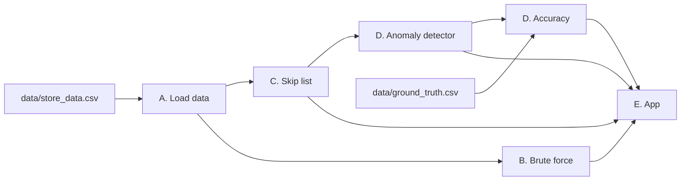

# Team Guide

This guide explains the whole project in plain words. **Everyone reads section 1.** Then read the
section for your part. Each part ends with "Be ready to explain": the questions you should be able
to answer in the presentation.

For full details and all result tables, see the topic guides:
[skip list](README_data_structure.md), [anomaly detection](README_anomaly.md), [app](README_ui.md).

## Contents

1. [The project in five minutes](#1-the-project-in-five-minutes)
2. [Part A: Data processing](#2-part-a-data-processing)
3. [Part B: Brute force](#3-part-b-brute-force)
4. [Part C: Skip list](#4-part-c-skip-list)
5. [Part D: Anomaly detection](#5-part-d-anomaly-detection)
6. [Part E: The app](#6-part-e-the-app)
7. [Troubleshooting](#7-troubleshooting)
8. [Glossary](#8-glossary)

---

## 1. The project in five minutes

### The task

> Build a simple database for time-stamped data (like sensor readings) that can quickly return all
> readings between two times. Use an index you build yourself (such as a Skip List or B-Tree)
> instead of scanning the whole dataset. Then add a basic anomaly-detection method on top that
> flags unusual spikes or drops.

We are graded on three things:

| Graded on | Part |
|---|---|
| A correct index | C (skip list) |
| Query speed compared with a simple scan | B (brute force) + C, measured by `04_benchmark.py` |
| Accuracy of the anomaly detection | D (anomaly detection) |

Parts A (loading the data) and E (the app) make the rest work and let us show it off.

### How the parts connect



1. **A** reads the CSV and turns each row into `(building_id, time_in_seconds, reading)`.
2. **C** puts those rows into the skip list so queries are fast.
3. **B** answers the same queries by checking every row. This proves the skip list is right and
   shows how much faster it is.
4. **D** asks the skip list for a building's readings, works out what's normal, and flags the
   readings that aren't.
5. **E** shows all of it in a web page.

### One query, start to finish

"Show building 107 from 2016-01-01 09:00 to 2016-01-02 08:00."

1. **A:** when the program starts, each CSV row becomes a tuple, for example `(107, 1451606400, 175.184)`.
2. **C:** each row goes into the skip list under the key `(107, time)`.
3. **C:** the query jumps to the first key at or after `(107, 09:00)`, then walks forward until it
   passes `(107, 08:00 next day)`. Result: **24 readings after 47 comparisons**.
4. **B:** the brute force checks **all 262,719 rows** and finds the **same 24 readings**.
5. **D:** the detector compares each of the 24 readings with the building's normal values.
6. **E:** the app draws the readings, the flags, and the timing of steps 3 and 4.

### The data

| | |
|---|---|
| `data/store_data.csv` | 262,719 rows: `building_id`, `timestamp`, `ts`, `meter_reading` |
| `data/ground_truth.csv` | the same rows with an `anomaly` column (0 or 1) instead of the reading |
| One row is | one **hourly** electricity reading of one building |
| Buildings | 192, all sharing the same timestamps |
| Time | 12 blocks of about 5 days (one per month of 2016), with gaps of about 25 days between them |
| Anomalies | 3,144 readings (1.2 %), in runs of consecutive hours (typically 3 hours, at most 36) |

### Numbers to remember

| | |
|---|---|
| Rows / buildings | 262,719 / 192 |
| Time to build the skip list | about 2 seconds |
| Skip list levels | 17 (about log2 of 262,719) |
| Query speed, all rows | skip list 6 to 17 µs, brute force 11 to 12 ms: hundreds to thousands of times faster |
| Best anomaly F1 | 0.63 on average (0.56 to 0.71) over 10 random splits |
| Tests | 61 (24 skip list, 25 anomaly, 12 app) |

### Files

| File | Part | What it is |
|---|---|---|
| `01_skiplist.py` | C | the skip list |
| `02_timeseries_store.py` | A + C | loading the CSV, making keys, answering queries |
| `03_brute_force.py` | B | the linear scan |
| `03_test_skiplist.py` | C | TEST: skip list, store, brute force |
| `04_benchmark.py` | B + C | RUN: speed comparison |
| `05_anomaly.py` | D | the anomaly detector |
| `06_evaluation.py` | A + D | loading labels; precision / recall / F1 |
| `06_test_anomaly.py` | D | TEST: detector and metrics |
| `07_run_anomaly_eval.py` | D | RUN: full accuracy evaluation |
| `08_ui_helpers.py` | E | helper functions for the app |
| `09_app.py` | E | RUN: the app |
| `09_test_ui.py` | E | TEST: the app |

The numbers show the build order. Python's `import` can't load names that start with a digit, so
the files load each other with `import_module("02_timeseries_store")`. Keep all `.py` files in the
same folder.

### Run everything

```bash
pip install -r requirements.txt
python -m pytest                   # all 61 tests (about 30 s)
python 04_benchmark.py             # speed comparison
python 07_run_anomaly_eval.py      # accuracy (about 1 min)
streamlit run 09_app.py            # the app
```

---

## 2. Part A: Data processing

**Goal:** turn the CSV files into simple Python data that every other part can use, and make sure
readings and labels line up exactly.

**Your code:** `to_epoch`, `epoch_to_datetime`, `timestamps_to_epochs` and `load_rows` in
`02_timeseries_store.py`; `load_ground_truth` in `06_evaluation.py`.

### What happens

1. Read the CSV with pandas.
2. Turn each `timestamp` into **seconds since 1970** (`2016-01-01 00:00:00` becomes `1451606400`).
   Whole numbers compare fast, and "one hour later" is just `+ 3600`. Both files go through the
   same function, so their times always match.
3. Make one tuple per row: `(building_id, seconds, reading)`.
4. For the labels, keep only rows with `anomaly == 1`, as a set of `(building_id, seconds)`.

### Decisions to justify

| Decision | Why |
|---|---|
| The key is `(building, time)`, not just time | All 192 buildings share timestamps, so time alone isn't unique. The pair also keeps each building's readings together. |
| Ignore the `ts` column | It's a rounded time that can be up to about 13 minutes off. `timestamp` is exact. |
| Match labels by key, not row number | If a file were ever re-ordered, matching by row number would silently shift every label. |
| Keep the `1.0` readings | 1,193 of the 1,195 readings equal to `1.0` are labelled anomalies. Deleting them would delete the answers. |
| Don't fill missing hours | Invented readings have no label and would distort the averages. |
| Don't scale the values | Each building is only compared with itself. |

```python
from importlib import import_module
store_module = import_module("02_timeseries_store")
rows = store_module.load_rows("data/store_data.csv")
print(len(rows), rows[0])                          # 262719 (107, 1451606400, 175.184)
print(store_module.to_epoch("2016-01-01 00:00"))   # 1451606400
```

### Be ready to explain
- Why the key is a pair, and what would go wrong with time alone.
- Why we ignore `ts`.
- Why we keep the `1.0` readings even though they look like bad data.

---

## 3. Part B: Brute force

**Goal:** the simplest possible way to answer a query: look at **every** row and keep the matching
ones. It has two jobs:

1. **Speed baseline:** the task asks us to compare against "a simple linear scan".
2. **Answer checker:** it's so simple it's obviously right. If the skip list gives the same
   answers, the skip list is right too.

**Your code:** `03_brute_force.py`.

```python
matches = [((b, e), v) for b, e, v in rows
           if b == building_id and start_epoch <= e <= end_epoch]
matches.sort(key=lambda item: item[0])
```

Every query reads all 262,719 rows, whether the answer has 3 readings or 3,000. That costs
**O(n)** per query, which is exactly what the skip list avoids.

The file has two versions of the scan:

- `brute_force_query_raw` works on exact times and is used by the tests and the benchmark.
- `BruteForceList` works on the CSV's rounded `ts` column and is used by the app. With whole-hour
  windows (all the app allows) it gives exactly the same rows.

**Fair comparison** (`04_benchmark.py`): same rows, same queries, same language, same result
format; each time is the best of several runs; every answer is checked before it is timed.

### Be ready to explain
- Why brute force must read every row (nothing tells it where a building's readings are).
- Why we sort the matches (so the output can be compared directly with the skip list's).
- Why the comparison is fair, and that a NumPy scan would be faster than our plain Python one.

---

## 4. Part C: Skip list

**Goal:** a sorted structure, written from scratch, that finds the start of a range in about
log(n) steps instead of n.

**Your code:** `01_skiplist.py`, the `TimeSeriesStore` class in `02_timeseries_store.py`, and
`03_test_skiplist.py`.

### The idea

A skip list is a **sorted linked list with express lanes**:

```
Level 3:  HEAD ---------------------------> 40 ------------------> None
Level 2:  HEAD ---------> 10 -------------> 40 ------> 70 -------> None
Level 1:  HEAD --> 5 ---> 10 --> 25 ------> 40 --> 55 --> 70 --> 90 -> None
```

**Search:** start at the top left. Go right while the next key is still smaller than your target.
When you can't, go down a level. On the bottom level, the next node is the first key that is >=
the target.

**Range query 20 to 60:** drop from level 3 (40 is too big). On level 2 move to 10, then drop
(40 is too big). On level 1 the next key is 25. Walk right: 25, 40, 55, and stop at 70. Most nodes
were never visited.

**Node heights come from coin flips.** Each new node goes up one more level with probability 0.5.
About half the nodes reach level 2, a quarter reach level 3, and so on. That keeps the list
balanced on average, with no rebalancing code.

| Operation | Expected cost |
|---|---|
| `insert`, `get`, `search` | O(log n) |
| `range_query(lo, hi)` | O(log n + k), where k = results returned |

### The store on top

| Method | What it does |
|---|---|
| `TimeSeriesStore.from_csv(path, seed=42)` | load the CSV and insert every row |
| `store.query(building, start, end)` | readings as `[(time, reading), ...]` |
| `store.query_raw(building, start_s, end_s)` | the raw skip list answer (this is what gets timed) |
| `store.buildings()`, `store.span(building)` | all building ids; first and last time for a building |

Inside, a query is just `skiplist.range_query((building, start), (building, end))`.

**Real example:** building 107 for 24 hours gives 24 results after 47 comparisons. For 5 days:
87 results after 110 comparisons. The brute force reads 262,719 rows either way. The skip list's
work grows with the size of the answer, not with the size of the database.

### Be ready to explain
- Why search is O(log n) on average (each level skips about half of the level below).
- What the random heights replace (rebalancing, as in a balanced tree).
- What happens when a key is inserted twice (its value is replaced).
- Why a range query is O(log n + k).
- Why the worst case is O(n) but practically never happens.
- Skip list vs B-Tree: simpler to write, no node splitting, but balanced only on average.

---

## 5. Part D: Anomaly detection

**Goal:** flag unusual readings with simple statistics, no machine learning, and measure how
accurate that is. Full details and results: [README_anomaly.md](README_anomaly.md).

**Your code:** `05_anomaly.py`, `06_evaluation.py`, `07_run_anomaly_eval.py`, `06_test_anomaly.py`.

### The idea in three steps

1. **Fetch** the building's whole history with one skip list range query.
2. **Describe normal:** the mean and the standard deviation (how much readings usually vary),
   optionally for each hour of the day.
3. **Flag** readings far from normal: `z = (reading - mean) / std`. If `z > k` it's a **spike**;
   if `z < -k` it's a **drop**.

Plus two rules we found in this dataset:

- **Stuck value:** a reading of exactly `1.0` (a "meter broken" placeholder).
- **Gap edge:** a reading right next to a hole of 2 to 6 missing hours.

And an optional **high-recall mode** that also flags the hour before and after each flag.

### The results in one sentence

The two rules together give the best F1, **0.63 on average (0.56 to 0.71) over 10 random
splits**. The z-score adds almost nothing on top of them. High-recall mode finds more anomalies
(recall 0.58) but with more false alarms (precision 0.62).

### How accuracy is measured

Only 1.2 % of readings are anomalies, so we use **precision** (how many flags were right),
**recall** (how many anomalies we found) and **F1** (both combined) instead of accuracy. We
choose `k` on half of the buildings and report scores on the other half, repeated over 10 random
splits.

### Good buildings for a demo

| To show | Buildings |
|---|---|
| Every anomaly found | 534, 701, 708, 730, 732, 739, 1141 |
| Red spikes and purple drops (set k = 3) | 159 (August block), 183, 890, 880, 881 |
| Gap-edge rule (green dots) | 240 (February block), 914, 935, 967 (March block), 1225, 1226 |
| A limitation (anomalies not found) | 148, 235, 945, 952, 966 |
| No anomalies at all | 118, 121, 293, 312 |

### Be ready to explain
- What a z-score is and why `|z| > k` means "unusual".
- Why we compare each building only with itself, and why per hour of day.
- Why readings next to a short gap are suspicious.
- Why we report precision / recall / F1 instead of accuracy.
- Why we split buildings into tune and test halves.
- The trade-off in high-recall mode, and why the app uses it.
- Why recall stays around 0.5 to 0.6 (many anomalies look completely normal by value).
- Where the skip list is used (every reading the detector sees comes from a range query).

---

## 6. Part E: The app

**Goal:** make everything visible: query a building, see the anomalies on a chart, compare skip
list and brute force live, and see the accuracy. Full details: [README_ui.md](README_ui.md).

**Your code:** `09_app.py` (the page), `08_ui_helpers.py` (logic that can be tested without a
browser), `09_test_ui.py`.

```bash
streamlit run 09_app.py
```

**How it is built:**

- Streamlit **re-runs the whole script on every click**. The slow steps (building the skip list,
  reading the labels) are cached with `@st.cache_resource` so they run only once.
- On each run: read the sidebar settings, run one range query for the window, run the detector,
  then draw the four tabs.

**Reading the chart:** a black diamond **without** a coloured dot is a real anomaly we missed.
A coloured dot **without** a diamond is a false alarm.

### Be ready to explain
- What each tab shows and how to read the chart.
- Why the app shows "identical results" (it proves the fast method is correct).
- Why timings change between machines and runs.
- Why Streamlit needs caching.

---

## 7. Troubleshooting

| Problem | Fix |
|---|---|
| "Could not find store_data.csv", or tests are skipped | Put both CSVs in a `data` folder next to the code, or set `STORE_DATA_CSV` and `GROUND_TRUTH_CSV`. |
| `ModuleNotFoundError` for one of our files | Run commands from the project folder, and keep all `.py` files together. |
| `NoSessionContext: Cursor is not set` in Streamlit | A side effect of an earlier error. Read the **last** error in the traceback. |
| The app ignores your code change | Stop it (Ctrl+C), start it again, and press `C` in the browser to clear the cache. |
| Your timings differ from the README | That's normal; they depend on the machine. The pattern (skip list flat, brute force growing) should match. |

---

## 8. Glossary

| Term | Meaning |
|---|---|
| **Epoch seconds** | time as seconds since 1970-01-01 00:00 |
| **Key** | what the skip list sorts by: `(building_id, epoch_seconds)` |
| **Range query** | "all readings of building X between time A and time B" |
| **Brute force / linear scan** | check every row, one after another |
| **Skip list** | a sorted linked list with random express lanes; search takes O(log n) |
| **O(n), O(log n)** | how the work grows as the number of rows n grows |
| **Mean** | the average reading |
| **Standard deviation (std)** | how far readings typically are from the mean |
| **z-score** | how many standard deviations a reading is from the mean: `(reading - mean) / std` |
| **Threshold k** | a reading is flagged when its z-score is above k or below -k |
| **Spike / drop** | a reading far above / far below normal |
| **Stuck value** | a reading of exactly `1.0`, a placeholder in this dataset |
| **Gap edge** | a reading right before or after 2 to 6 missing hours |
| **High-recall mode** | also flag readings within 1 hour of a flag: more anomalies found, more false alarms |
| **Precision / recall / F1** | share of flags that were right / share of anomalies found / both combined |
| **Event recall** | share of anomaly runs where at least one reading was flagged |
| **Ground truth** | `ground_truth.csv`, the labels saying which readings are anomalies |
| **Tune / test split** | choose settings on half the buildings, report scores on the other half |
